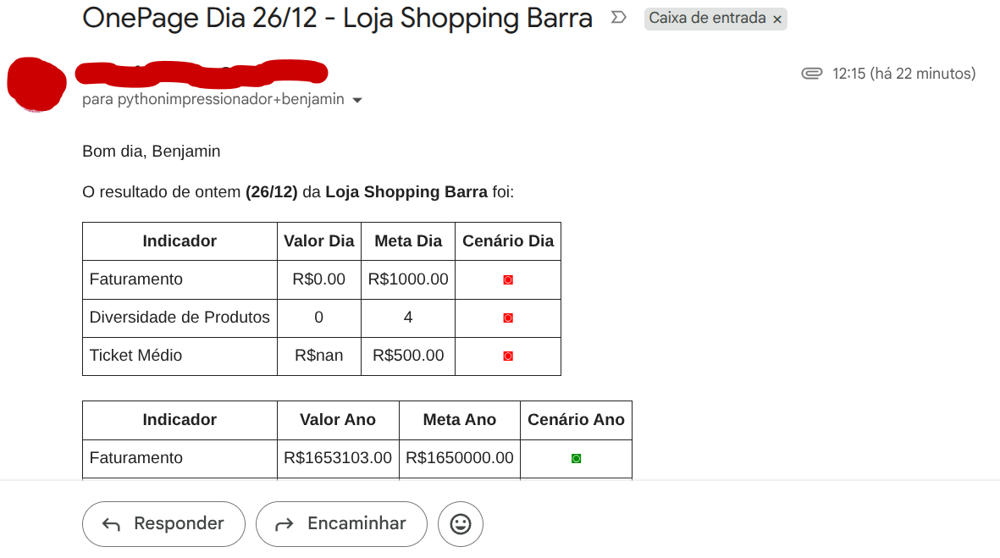
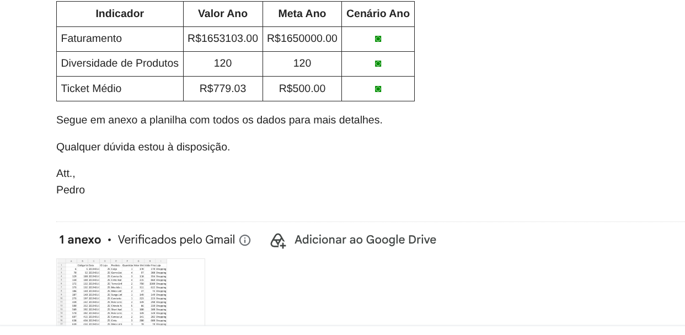
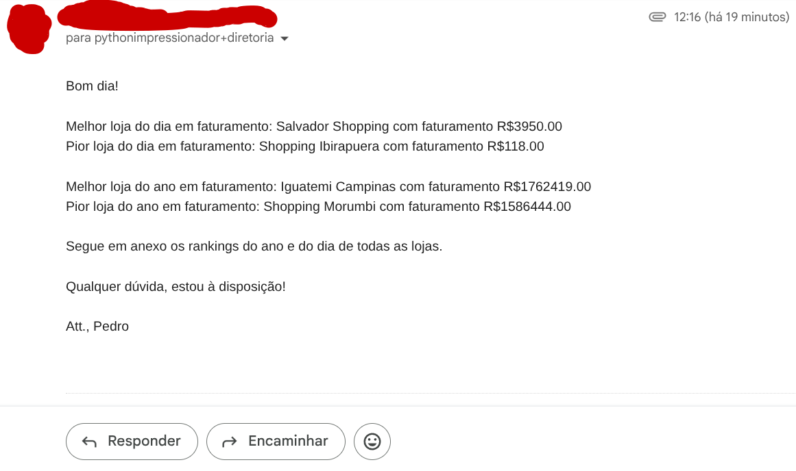
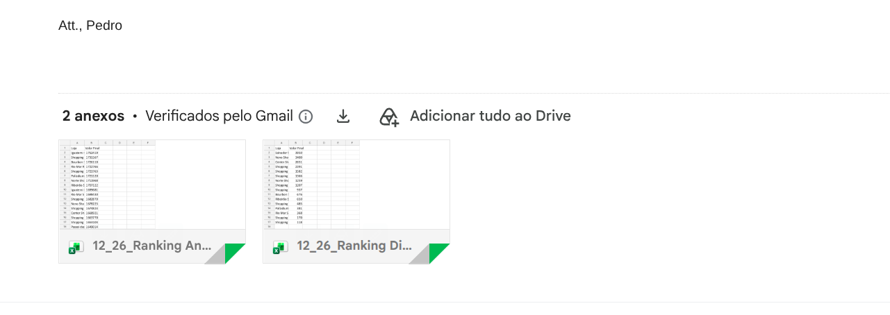

# Automação de Indicadores - E-mail

Envio automatizado de indicadores de vendas por e-mail.

---

## Demonstração

| Envio de E-mail OnePage (pt1) | Envio de E-mail OnePage (pt2)  |
| :---: | :---: |
|  |  |

| Envio de E-mail Diretoria (pt1) | Envio de E-mail Diretoria (pt2)  |
| :---: | :---: |
|  |  |

---

## Tecnologias

Este projeto foi desenvolvido utilizando as seguintes tecnologias:

- **Python 3.12.3**
- **Pandas e OpenPyXL (Manipulação e leitura de planilhas)**
- **Python-Dotenv (Gerenciamento de variáveis de ambiente)**
- **SMTPLib e EmailMessage (Automação e envio de e-mails)**

---

## Funcionalidades

- [x] Leitura de bancos de dados em Excel e csv
- [x] Análise de indicadores
- [x] Envio de indicadores para cada loja (OnePage)
- [x] Envio de acompanhamento de indicadores para a diretoria

---

## Estrutura de Dados

O projeto conta com uma pasta `Bases de Dados/` contendo arquivos de exemplo fictícios (`Emails.xlsx`, `Lojas.csv` e `Vendas.xlsx`) para permitir testes imediatos após a clonagem. Os relatórios gerados e rankings são salvos automaticamente na pasta `Backup Arquivos Lojas/`.

---

## Como Executar o Projeto

### Pré-requisitos

Antes de começar, você precisará ter instalado em sua máquina:
- [Git](https://git-scm.com)
- [Python 3.12](https://www.python.org/)

### Passo a Passo

1. **Clone este repositório:**
   ```bash
   git clone https://github.com/Brazil25/automacao_indicadores_lojas
   ```

2. **Acesse a pasta do projeto:**
   ```bash
   cd automacao_indicadores_lojas
   ```

3. **Crie e ative o ambiente virtual (opcional, mas recomendado):**
   ```bash
   python -m venv .venv
   source venv/bin/activate  # Linux/Mac
   # ou: venv\Scripts\activate  # Windows
   ```

4. **Instale as dependências:**
   ```bash
   pip install -r requirements.txt
   ```

5. **Configure as variáveis de ambiente**
   - Duplique o arquivo .env.example, renomeie para .env e preencha com a sua senha de app do Gmail e o seu e-mail de teste.

6. **Execute a aplicação:**
   ```bash
   jupyter nbconvert --to notebook --execute "Automacao de Processo.ipynb"
   ```

---

## Licença

Este projeto está sob a licença MIT.
